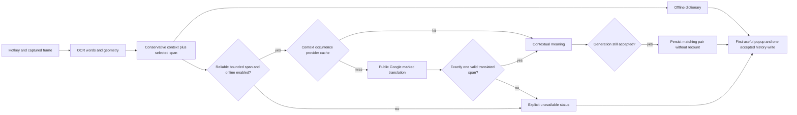

# Phase 5.1: Multiline context and contextual meaning — Research

**Researched:** 2026-10-27
**Domain:** Tesseract text-block recovery, occurrence-specific translation, asynchronous desktop enrichment
**Confidence:** HIGH for observed probes/code contracts; MEDIUM for continued availability and general translation quality.

<user_constraints>
## User Constraints (from CONTEXT.md)

### Locked Decisions
- **D-01:** Reuse Tesseract word geometry, block/paragraph/line identifiers and current bounded selection. Exclude columns, captions and distinct dialogue; ambiguous boundaries retain an explicitly limited fragment. Handle sentence boundaries and line-end hyphenation without inventing text.
- **D-02:** Carry the selected occurrence through recovery, provider request, cache and persistence; repeated occurrences must remain distinguishable.
- **D-03:** Research and live-verify an accessible contextual method before implementation. Require different appropriate Russian senses for river/financial `bank`, including repeated words. Isolated word translation and whole-sentence translation alone cannot satisfy TRAN-06. Do not require closed Lookupper services or local models.
- **D-04:** Show offline articles immediately, then enrich asynchronously. Keep sentence translation and contextual word meaning separate. Offline, disabled online mode, timeout, invalid response and unreliable context have explicit statuses.
- **D-05:** Cache by context, occurrence and provider. Persist meaning with its exact context. Enrichment must not increment counts again or mutate a newer/closed popup. Retain the existing generation/cancellation boundary.
- **D-06:** Send only needed text, never images; preserve privacy-safe timings for first useful result and contextual completion.
- **Agent discretion:** Choose the smallest complete implementation following current stdlib/PyQt patterns; routine technical choices authorized by --auto. Record a genuine unavailable-provider blocker rather than inventing successful evidence.

### Deferred Ideas (OUT OF SCOPE)
Words/review/export remain Phase 6; settings and packaging Phase 7; real fullscreen games and performance acceptance Phase 8. Real MDX/DSL and other prior verification limitations remain recorded.
</user_constraints>

## Project Constraints (from AGENTS.md)

[VERIFIED: supplied AGENTS.md instructions in task context; no root AGENTS.md found by Test-Path] Execute safe scoped work autonomously, preserve user changes, use rg and apply_patch, keep output bounded, test proportionately and report exact verification limits. Under `--auto`, make routine decisions without checkpoints, label agent acceptance honestly and stop only for a genuine blocker or destructive action beyond scope. No project-local `.codex/skills` or `.agents/skills` files were found by rg.

<phase_requirements>
## Phase Requirements

| ID | Required behavior | Research support |
| --- | --- | --- |
| CAPT-05 | Recover a sentence across lines of one block, handle hyphenation, exclude neighboring material, retain bounded fragment when uncertain. | Existing TSV identities/geometry can support conservative grouping; add occurrence offsets and explicit fragment status. [VERIFIED: lookup/ocr.py; .planning/REQUIREMENTS.md] |
| TRAN-06 | Separate contextual Russian word meaning, even with offline article; occurrence/context-specific cache and persistence; explicit failure statuses. | Eight live marked-sentence cases validate an available occurrence-specific extraction method; existing asynchronous callback/generation flow can host it. [VERIFIED: provider-probes.json; lookup/translate.py; lookup/app.py] |
</phase_requirements>

## Summary

[VERIFIED: provider-probes.json, probe_context_provider.py] An accessible method passed the required live gate: translate the whole public synthetic sentence with exactly the selected occurrence wrapped in `<b>...</b>`, using the existing public Google `translate_a/single` endpoint and `client=gtx`, then extract only the translated marked span. The selected river `bank` yielded `берегу`, financial `bank` yielded `банк`; selecting different occurrences of the same repeated-word sentence yielded `Берег` and `банком`. All eight ordinary marked cases returned HTTP 200 and one valid span, including multiline text, two sentences and `break out` → `вырваться`. This is contextual **span extraction**, not displaying the sentence translation as the word meaning.

[VERIFIED: provider-probes.json; CITED: https://docs.cloud.google.com/translate/docs/translate-text] This experiment verifies current behavior for the stored cases only. Google Cloud documents HTML preservation in its authenticated Cloud Translation API; that documentation does **not** guarantee the public `gtx` endpoint or universal semantic alignment. `/translate_a/t?client=te&format=html` returned 403 for all tested cases and must not be selected. Literal escaped source markup produced malformed translated markup in a negative case; fail closed. Do not interpret a preserved tag as a guarantee of correct alignment on every sentence.

**Primary recommendation:** Implement bounded `google-gtx-marked-v1` extraction with strict validation and explicit unavailable status, then integrate it through existing ready/context events. Do not add credentials, LLMs, dependencies or a heuristic Russian word guesser. [VERIFIED: successful probes and existing integration seams]

## Architectural Responsibility Map

| Capability | Primary owner | Secondary owner | Rationale |
| --- | --- | --- | --- |
| Recover context and occurrence offsets | OCR core | Application source adapter | All source words and geometry exist before translation. [VERIFIED: lookup/ocr.py, lookup/app.py] |
| Marked request and validated extraction | Online provider module | Translation orchestrator | Existing network/privacy boundary owns endpoint and response limits. [VERIFIED: lookup/online.py] |
| Cache and matching history pair | SQLite store | Current application worker | Connection belongs to the worker; accepted generation owns one count update. [VERIFIED: lookup/store.py, lookup/app.py] |
| Early article and late contextual value | Popup/controller | Translation callbacks | Existing ready/context stages already separate article and sentence translation. [VERIFIED: lookup/gui.py, lookup/translate.py] |

## Standard Stack

| Component | Verified environment/API | Use |
| --- | --- | --- |
| Python stdlib | Host Python 3.14.3 | Dataclasses, html/html.parser, urllib, threading, sqlite3; no package addition. [VERIFIED: python --version; current imports] |
| PyQt6 | Import spec available on host; exact version not probed | Existing plain-text popup and generated OCR fixtures. [VERIFIED: importlib.util.find_spec; lookup/gui.py] |
| Tesseract TSV | Existing output parser; no host executable | Word geometry and page/block/paragraph/line identifiers. [VERIFIED: lookup/ocr.py; shutil.which; CITED: https://tesseract-ocr.github.io/tessdoc/Command-Line-Usage.html] |
| Google public endpoint | Live HTTP 200, `client=gtx&dt=t&sl=en&tl=ru` | Marked-sentence translation with occurrence-specific extraction. [VERIFIED: provider-probes.json] |

No dependency upgrade is needed. Do not pin speculative new package versions. [VERIFIED: integration can use existing imports plus stdlib html.parser]

### Alternatives investigated

- DeepL officially supports a `context` parameter and HTML handling, but API calls require authentication; no API key was supplied or probed. It remains a future authenticated alternative, not the selected implementation. [CITED: https://developers.deepl.com/api-reference/translate/request-translation; https://github.com/DeepL/deepl-python]
- MyMemory's documented search parameters provide segment translation, not selected-occurrence alignment. Do not silently use its sentence result as a contextual word value. [CITED: https://mymemory.translated.net/doc/spec.php]
- Google Cloud provides a documented HTML-capable translation API with credentials; its documentation corroborates the technique, not access to a credential-free contractual service. [CITED: https://docs.cloud.google.com/translate/docs/translate-text]

## Architecture Patterns



Recommended implementation boundaries below are prescriptions grounded in the verified seams, not claims that the new behavior already exists. [VERIFIED: code inspection]

### 1. Recover context before whitespace normalization

[VERIFIED: lookup/ocr.py] `Word.line_id` is `(page, block, paragraph, line)` and `Word.order` identifies word order. `Selection` currently contains only normalized word, one-line text, candidates, box and confidence. `select_word` currently limits candidates to its selected line. Add defaults to new Selection fields to preserve callers constructing Selection positionally.

Use same paragraph/block plus geometry to gather a bounded 2–4-line neighborhood; reject large interline gaps, unrelated x ranges, distinct dialogue starts and ambiguous blocks. Tesseract identities are grouping evidence, not proof that neighboring visual material is semantically one sentence. Stop at reliable punctuation around the selected occurrence; otherwise retain fragment status. [VERIFIED: available identifiers in parser; CITED: Tesseract TSV documentation]

Carry exact source occurrence offsets into the recovered context. Handle a line-end hyphen using explicit, conservative rules and record the selected span after joining. Keep context recovery independent of dictionary phrase selection so choosing a candidate cannot silently move selection to another occurrence. [VERIFIED: choose_query currently returns only text, app.Source.resolve discards selection identity]

### 2. Mark the occurrence and extract only validated text

[VERIFIED: provider-probes.json] Send the entire required context, mark only offsets selected by OCR, and extract the translated marked phrase. Inflected forms such as `берегу`/`банком` are observed context-dependent translations; do not claim dictionary lemmas or explanations.

Provider request contract: `https://translate.googleapis.com/translate_a/single?client=gtx&dt=t&sl=en&tl=ru&q=...`. Use current `_request` transport/deadline behavior rather than the research probe transport. Identify the method as `google-gtx-marked-v1` in cache/payloads. [VERIFIED: probe inputs; lookup/online.py request implementation]

Require integer offsets `0 <= start < end <= len(context)`, exact source substring correspondence, bounded request size, and no control characters. Do not truncate context after computing offsets; shrink first or refuse unreliable context. Escape source text, insert exactly one literal `<b>` pair, and reject unsafe source angle-bracket markup. Provider escaping is not a reliable defense by itself: the stored `escaped-source` probe reintroduced a literal `<b>` and the extractor rejected its malformed output. [VERIFIED: escaped-source probe; lookup/online.py.prepare_text truncation behavior]

Parse and validate the entire translated output: exactly one balanced `<b>` pair, no attributes/nested tags/comments/declarations, no extra spans, bounded nonempty plain text; reject echoed source and unsuitable non-Russian output. Return fixed statuses on any mismatch. Never choose an arbitrary token from the full sentence. [VERIFIED: successful spans/negative controls; CITED: https://docs.python.org/3/library/html.parser.html]

Python's HTMLParser accepts invalid markup and does not enforce matching start/end tags; implement explicit balance and allowed-token validation. Keep the result in existing plain-text labels, never render returned HTML. [CITED: https://docs.python.org/3/library/html.parser.html; VERIFIED: lookup/gui.py plain-text rendering]

### 3. One worker owns SQLite; stale updates cannot write

[VERIFIED: lookup/translate.py, lookup/app.py] `lookup(... on_ready=...)` emits an early result before joining the sentence-context thread. `Coordinator._process` calls with `save=False`, guards current generation under a condition, and writes history exactly once in `ready`. Late `context` events already check identity. Reuse these boundaries for contextual enrichment; do not perform SQLite operations in the network thread.

[VERIFIED: lookup/store.py] Current schema is v2; `translations.kind` only permits word/phrase/sentence and its primary key omits provider. Add a migration for the contextual cache and matching persisted fields or a dedicated relation; do not insert a new kind into the existing checked column without migration. Current stored contexts are capped at 500 characters; align recovered-context bounds with persistence or extend them deliberately, otherwise contextual meaning can refer to text no longer stored.

Cache identity must include method/provider version, exact context, source selection/offsets and target language. Hashing this identity is acceptable with stdlib, but not needed as a separate cache framework. Preserve the chosen meaning with the exact same context/selection. On a new accepted search, clear/replace stale sense fields even if enrichment later fails. Late enrichment uses a guarded UPDATE, never upsert_word, and must not overwrite another generation or a manually saved Phase 6 card snapshot. [VERIFIED: current upsert_word increments count; Phase 5.1 criteria]

### 4. Separate states and timing

[VERIFIED: lookup/gui.py] `context_value` currently means sentence translation, and `update_context` handles pending/busy/error. Add an independently labeled contextual-meaning field with ready/pending/disabled/no-context/timeout/bad-response status rather than relabeling sentence translation. Keep the offline article visible throughout. Add privacy-safe contextual duration alongside existing first ready elapsed time; durations are measurements, not Phase 8 performance acceptance.

## Don't Hand-Roll

| Problem | Avoid | Use instead |
| --- | --- | --- |
| Russian alignment | Guessing a Russian token by relative position or selecting dictionary sense by keyword lists | Verified marked-span method, with refusal on uncertain output. [VERIFIED: live probes] |
| Networking/security | New HTTP library or alternate retry loop | Existing bounded urllib transport, redirect refusal and reason codes. [VERIFIED: lookup/online.py] |
| Persistence | New ORM or unguarded background SQLite connection | Existing versioned migration and worker ownership. [VERIFIED: lookup/store.py; lookup/app.py] |
| HTML validation | Trusting HTMLParser to validate balance or rendering provider markup | Explicit allowlist/balance plus plain text GUI. [CITED: Python HTMLParser docs; VERIFIED: lookup/gui.py] |

## Common Pitfalls

- `context.find(word)` always selects the first repeated occurrence; retain selected geometry identity and calculated offsets instead. [VERIFIED: current Selection has no offsets; repeated live cases differ]
- Word normalization can remove possessives/punctuation or case; source span and lookup key are different values. [VERIFIED: lookup.normalize use in lookup/ocr.py]
- Sentence translation is already cached by normalized sentence; reusing that entry for the sense loses selected occurrence and provider identity. [VERIFIED: lookup/translate.py cache_get/cache_put]
- Matching tags do not prove universal semantic alignment. Adversarial repeated-word tests and honest failure statuses remain required; the current eight cases establish a viable method, not a general quality guarantee. [VERIFIED: finite probe corpus]
- `HTMLParser` is tolerant; omitted closing tags, nested spans, comments and character-reference surprises need explicit negative tests. [CITED: Python HTMLParser docs]
- Returning after close/new trigger protects the popup but may still leave a stale database update if storage happens before the generation guard. Keep storage under that same guard. [VERIFIED: lookup/app.py ready guard]

## Code Examples

Research probe result shape, reduced from the preserved live JSON: [VERIFIED: provider-probes.json]

```python
# Public synthetic input only:
q = 'The <b>bank</b> of the river is next to the bank that holds my savings.'
# Joined translated segment text contains one marked span:
# '<b>Берег</b> реки находится рядом с банком, где хранятся мои сбережения.'
# Selected meaning = 'Берег'; sentence translation remains a separate field.
```

Recommended construction, with prevalidation and strict response validation still required: [CITED: https://docs.python.org/3/library/html.html]

```python
marked = (html.escape(context[:start]) + '<b>'
          + html.escape(context[start:end]) + '</b>'
          + html.escape(context[end:]))
```

## Environment Availability

| Dependency | Available here | Fallback / limit |
| --- | --- | --- |
| Python | 3.14.3 | Existing stdlib unittest runs. [VERIFIED: python --version] |
| PyQt6 | Import spec found | Existing GUI tests; version not measured. [VERIFIED: importlib probe] |
| Tesseract executable | Not on host PATH | Geometry/unit tests can run locally; real OCR image checks need existing Arch VM or installed executable. VM availability not probed by this researcher. [VERIFIED: shutil.which('tesseract')] |
| Public Google gtx | HTTP 200 for ten requests; eight positive marked cases | Fail closed if endpoint unavailable; no availability contract established. [VERIFIED: provider-probes.json] |
| Public Google te HTML route | HTTP 403 for all ten cases | Do not use. [VERIFIED: provider-probes.json] |
| Authenticated DeepL/Cloud Translation | Not probed; no key supplied | Not needed for selected live-verified method. [VERIFIED: task scope; CITED: official API docs] |

## Validation Architecture

[VERIFIED: tests directory and parent's fresh baseline report] Framework is stdlib unittest. Parent ran `python -m unittest tests.test_ocr tests.test_translate_ready tests.test_app tests.test_store`: 46 tests passed before implementation. Full suite command is `python -m unittest discover -s tests`; platform-dependent tests must report skips honestly.

| Requirement | Behavior and test layer | Command / planned gap |
| --- | --- | --- |
| CAPT-05 | Unit: 2–4 lines, two sentences, columns, captions, distinct dialogue, line-end hyphen, uncertain boundary, repeated source offsets | Extend `tests.test_ocr`; keep existing proximity/phrase tests. [VERIFIED: existing test module] |
| CAPT-05 | Real Tesseract on generated multiline images at supported scale factors | Extend `tests.test_ocr_image` fixtures/harness; VM/executable required for actual OCR. [VERIFIED: existing test module and absent host executable] |
| TRAN-06 | Provider fixture tests: eight captured positive cases; no span/malformed span/nested tags/attributes/comments/empty/echo/wrong language/oversize output | New `tests.test_context` or targeted online test cases; provider JSON exists now. [VERIFIED: provider-probes.json] |
| TRAN-06 | Cache separates same word/context/occurrence/provider; invalid cache rejected | Add contextual cache tests plus migrations from existing v2, preserving word counts. [VERIFIED: current schema and criteria] |
| TRAN-06 | Offline article ready before delayed contextual reply, disabled online sends nothing, pending/failure does not erase article | Extend `tests.test_translate_ready`. [VERIFIED: existing test module] |
| TRAN-06 | Superseded/dismissed request cannot repaint or enrich history; enrichment count unchanged; matching pair persists | Extend `tests.test_app`, `tests.test_store`, GUI tests. [VERIFIED: existing modules and generation contract] |
| TRAN-06 | Live public synthetic bank senses and repeated occurrence | `python .planning/phases/05.1-context/probe_context_provider.py`; inspect/revalidate JSON rather than treating HTTP 200 alone as success. [VERIFIED: executed probe] |

Per task, run the directly affected test modules; per wave, run full unittest discovery. Add a fast explicit assertion over positive/negative fixture outcomes before the phase gate. Agent-run fixture/VM checks are agent evidence; no human acceptance is implied. [VERIFIED: supplied AGENTS.md instructions]

## Security Domain

[VERIFIED: .planning/config.json] Security enforcement is enabled. This desktop text-translation change has no new login/session/auth surface (ASVS V2/V3 not applicable). Relevant controls are input validation/output handling, data protection, communications, and parameterized SQLite; apply those concrete controls rather than invent a web authentication layer. [VERIFIED: code architecture]

| Threat | Mitigation |
| --- | --- |
| Provider returns markup or injected content | Strict structural parser, character/length limits, plain-text GUI only. [VERIFIED: live escaped-source failure; current GUI] |
| User text or response leaks through logs/errors | Fixed reason codes and numeric timings; never log context, meaning, request URL or network exception text. [VERIFIED: existing privacy convention in online/store modules] |
| Response/redirect abuse | Existing endpoint-bound bounded transport, no redirect forwarding; reuse timeout and response caps. [VERIFIED: lookup/online.py] |
| Cross-context or stale-record poisoning | Cache identity includes context/occurrence/provider; guarded exact-pair update with no recount. [VERIFIED: current schema gap and app guard] |
| SQLite corruption/injection | Existing transaction-safe migrations and parameterized values. [VERIFIED: lookup/store.py] |

## Assumptions Log

No unverified package capability is required for the recommendation. Endpoint future availability and semantic accuracy on unseen text are **unproven limitations**, not assumptions promoted to locked guarantees. [VERIFIED: finite live corpus; no gtx API contract found in checked official docs]

## Questions Resolved for Planning

**RESOLVED for planning:** The three dispositions below are adopted. They retain implementation and acceptance checks; they are not claims of universal correctness or completed OCR validation.

1. Universal word alignment remains unproven. The selected method is acceptable for planning because required live examples pass; expand adversarial fixture corpus and retain refusal/status paths. [VERIFIED: finite evidence]
2. Real Tesseract paragraph separation for adjacent dialogue depends on images. Use generated fixtures and actual OCR/VM evidence before CAPT-05 acceptance; geometry-only tests alone are insufficient. [VERIFIED: current parser data and missing host executable]
3. Public endpoint is undocumented in the checked Google Cloud docs. If it later fails, report contextual unavailability without fallback to unrelated dictionary/sentence values; authenticated provider integration would require separately supplied credentials. [VERIFIED: live route comparison; CITED: Google Cloud docs]

## Sources and Evidence

- `.planning/phases/05.1-context/provider-probes.json` — full synthetic request parameters, bounded raw responses, HTTP status, extraction and durations; 2026-10-27. [VERIFIED]
- `.planning/phases/05.1-context/probe_context_provider.py` — reproducible research-only probe. Its permissive experimental extractor is **not** production-ready; production needs the additional validation prescribed above. [VERIFIED]
- `lookup/ocr.py`, `lookup/app.py`, `lookup/translate.py`, `lookup/store.py`, `lookup/online.py`, `lookup/gui.py` — inspected implementation seams. [VERIFIED]
- https://docs.cloud.google.com/translate/docs/translate-text — authenticated Google Cloud HTML capability; not gtx specification. [CITED]
- https://developers.deepl.com/api-reference/translate/request-translation and https://github.com/DeepL/deepl-python — authenticated context-capable alternative. [CITED]
- https://mymemory.translated.net/doc/spec.php — segment query parameters. [CITED]
- https://docs.python.org/3/library/html.parser.html and https://docs.python.org/3/library/html.html — stdlib parser tolerance/escaping. [CITED]
- https://tesseract-ocr.github.io/tessdoc/Command-Line-Usage.html — TSV output and hierarchy. [CITED]
- `docs/lookupper/architecture.md`, `docs/lookupper/linux-requirements.md`, `docs/lookupper/evidence.md` — project canonical contracts and observed/claimed boundaries. [VERIFIED: read during research]

## Metadata

**Standard stack:** HIGH — existing code, executable/import probes and official stdlib docs.
**Integration architecture:** HIGH — direct inspection of current ownership and callbacks.
**Provider feasibility:** HIGH for the recorded cases; MEDIUM for generalized quality; no contractual uptime claim.
**Validation freshness:** Re-run public probes before phase acceptance; do not assume an undocumented endpoint stays stable.
