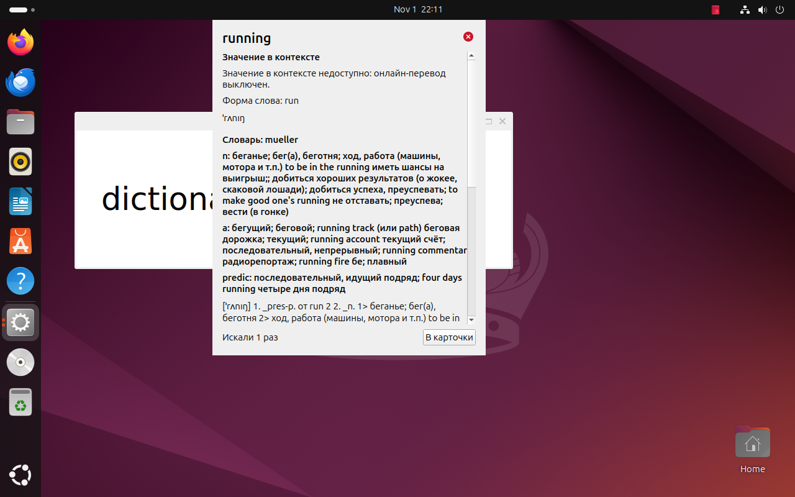

<p align="center"></p>

<p align="center"><strong>English → Russian. Right where you read.</strong><br>A cursor dictionary, OCR translator and vocabulary companion for KDE Plasma and GNOME Wayland.</p>

Ubuntu 24.04 with GNOME Wayland: [setup and VM checks](docs/UBUNTU.md).

<p align="center">
<a href="https://github.com/EstySD/LookUpLinux/releases"></a>
<a href="https://github.com/EstySD/LookUpLinux/actions/workflows/ci.yml"></a>
<a href="LICENSE"></a>


</p>

<p align="center"><a href="https://github.com/EstySD/LookUpLinux/releases">Downloads</a> · <a href="docs/README.ru.md">Русская инструкция</a> · <a href="docs/DICTIONARIES.md">Get dictionaries</a> · <a href="CONTRIBUTING.md">Contribute</a> · <a href="https://github.com/EstySD/LookUpLinux/issues">Report a bug</a></p>

## Point. Press. Understand.

Hover over an English word and press **Meta+Shift+D**. LookUp opens a nearby
dictionary card and, when available, a translation of the surrounding text.
Freshly selected text takes priority over OCR. Save a word and review it later
without switching to a browser.

- **Read across applications:** cursor OCR and selected-text lookup.
- **Open the interface:** launch LookUp Linux from the application menu (`lookup --app`) for shortcut instructions, settings, words and review. Closing this window keeps translation running; click the tray icon to reopen it. `lookup --background` starts directly in the tray.
- **Bring your dictionaries:** StarDict, Lingvo DSL / compressed DSL, MDX, and Yomitan v3 ZIP (plain and structured text). Copy Yomitan ZIPs into the dictionary folder without extracting them, then apply settings. Replace the same filename to update a dictionary; invalid archives show an error beside their name while other dictionaries remain available.
- **Keep the context:** optional online sentence translation and word meaning in context.
- **Build your vocabulary:** history, learning cards and scheduled review.
- **Export your words:** CSV and Anki text files.
- **Make it yours:** tray settings for shortcut, dictionary order, online access and autostart.

<p align="center"><br><sub>Real Ubuntu 24.04 / GNOME Wayland capture. Local Mueller dictionary added separately; online translation disabled for this test.</sub></p>

## Platform support

| Platform | Status | Distribution |
| --- | --- | --- |
| Arch Linux x86_64 · KDE Plasma 6 · Wayland | Target platform | Native `.pkg.tar.zst` and build kit |
| Ubuntu 24.04 · GNOME 46 · Wayland | Agent-tested desktop preview | [Source + GNOME extension](docs/UBUNTU.md) |
| Other Linux distributions / desktops, X11, ARM | Unsupported | Porting contributions welcome |
| Windows / macOS | Unsupported | No application builds |

Early **0.2.0** release. OCR depends on font size, contrast and application.
Fullscreen games require individual testing. Cross-platform core tests do not
imply desktop support on those operating systems.

## Install on Arch Linux

Choose the **Arch Linux x86_64** package from
[Releases](https://github.com/EstySD/LookUpLinux/releases) when a published release
is available. Download `SHA256SUMS` beside it, then run:

```bash
sha256sum --ignore-missing -c SHA256SUMS
sudo pacman -U ./lookup-linux-0.2.0-1-x86_64.pkg.tar.zst
lookup --app &
```

Checksums detect damaged downloads; they are not publisher signatures. Draft
releases are visible only to maintainers. If there is no published package, build
from source below.

**Add a dictionary for offline definitions.** Public packages do not bundle
dictionary databases. See [dictionary downloads and setup](docs/DICTIONARIES.md).
Online translation is enabled by default and requires a network connection.

### Build from source

```bash
sudo pacman -S --needed base-devel python git
git clone https://github.com/EstySD/LookUpLinux.git
cd LookUpLinux
python tools/stage_package.py --public --output "$HOME/lookup-linux-build"
cd "$HOME/lookup-linux-build"
makepkg -si
lookup --app &
```

Use a new or empty build directory. Build as an ordinary user; `makepkg -si`
requests elevated privileges for dependencies and installation. The recipe
downloads a checksum-pinned kdotool helper; no separate AUR install is needed.
The root recipe without `--public` is a legacy local build including Mueller 7;
public releases use the separate recipe without dictionary data.

## First lookup

1. Start `lookup --app` and wait for the tray icon.
2. Open **Settings → Open dictionary folder**, add dictionary files, then apply settings.
3. Hover over English text and press **Meta+Shift+D**.
4. Save words as cards; open the words or review window from the tray.

For shortcut problems, run `lookup --doctor` in your Plasma session. Start the
app first so it can register its shortcut. An occupied shortcut is not taken over.

```bash
lookup --doctor
lookup --list-dicts
lookup --word bank --offline --no-save
lookup --text "They sat by the river." --no-save
```

## Privacy and offline use

Local dictionaries and cards work offline once a dictionary is installed.
Disable online access in Settings for offline use. When enabled, selected text
and needed context may be sent to Google or MyMemory. OCR screenshots are
processed locally and are not sent to translation services or stored in history.

Online translation uses public endpoints, including an undocumented Google
endpoint. Availability, rate limits and quality are not guaranteed. An online
error does not hide a ready offline definition.

History and cards: `~/.local/share/lookup/lookup.db`; configuration:
`~/.config/lookup/config.json`; rebuildable indexes: `~/.cache/lookup`.
Uninstalling preserves personal data. The [Russian guide](docs/README.ru.md)
covers settings, exports and removal in detail.

## Development and community

See [Contributing](CONTRIBUTING.md), [Security](SECURITY.md) and the
[changelog](CHANGELOG.md). English and Russian bug reports are welcome.
Include your Plasma version, session type and sanitized `lookup --doctor` output.

## License and acknowledgements

Original code and documentation: **GPL-3.0-or-later**. See [LICENSE](LICENSE),
[licensing details](COPYING.md) and [third-party notices](packaging/THIRD-PARTY.md).
Built with Python, PyQt6, KDE Plasma, Tesseract and kdotool. Word-form exceptions
include WordNet-derived data with its upstream notice. Dictionary licenses are separate.
