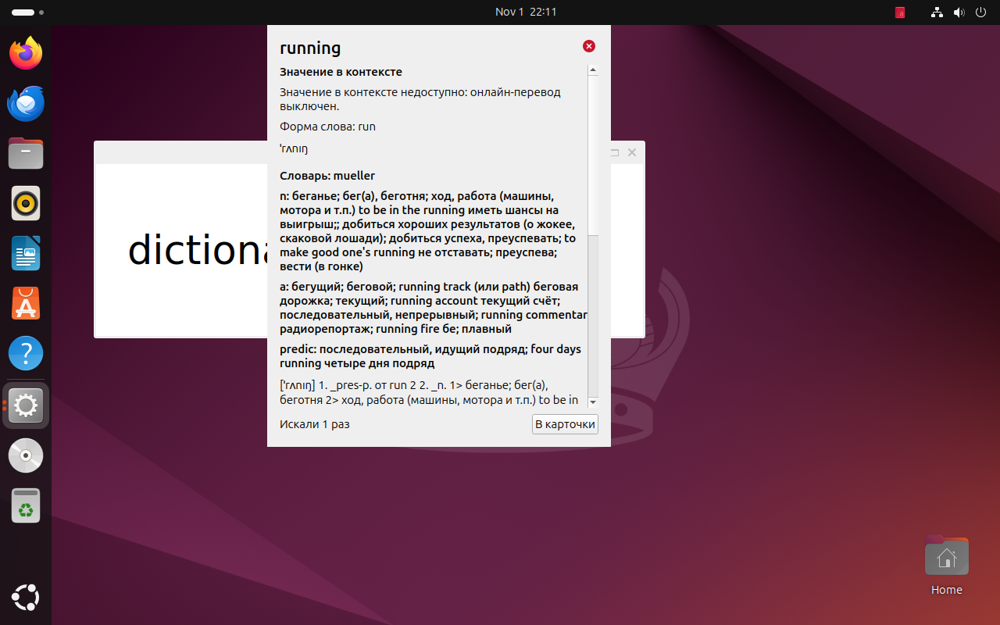

# LookUp Linux 0.2.1 — reliability and snapshot selection

**English → Russian. Right where you read.**

Hover over a word, press **Meta+Shift+D**, and read its definition beside your
text. Save learning cards, revisit your vocabulary and export to Anki.

This release adds an **Ubuntu 24.04 / GNOME 46 desktop preview**, while preserving
the existing **Arch Linux / KDE Plasma 6 Wayland** backend.



*Real GNOME screenshot with a separately added local dictionary. Online
translation was disabled during this captured test; it is enabled by default.*

## Choose your download

| System | Asset | Install |
| --- | --- | --- |
| **Arch Linux x86_64 · KDE Plasma 6 Wayland** | `lookup-linux-0.2.1-1-x86_64.pkg.tar.zst` | `sudo pacman -U ./lookup-linux-0.2.1-1-x86_64.pkg.tar.zst` |
| **Arch Linux · build locally** | `lookup-linux-0.2.1-archlinux-x86_64-build-kit.tar.gz` | Extract, enter the build-kit directory, run `makepkg -si` |
| **Ubuntu 24.04 · GNOME 46 Wayland preview** | `lookup-linux-0.2.1-source.tar.gz` | Follow the Ubuntu instructions below; no `.deb` is provided |
| **Development / other ports** | `lookup-linux-0.2.1-source.tar.gz` | See README and CONTRIBUTING; Windows/macOS/X11 are not supported application targets |

Download `SHA256SUMS` and verify your files:

```bash
sha256sum --ignore-missing -c SHA256SUMS
```

Checksums detect download corruption; they are not publisher signatures.

## Ubuntu quick start

Extract the source archive, then run these commands **as your normal user inside
the GNOME Wayland desktop**:

```bash
sudo apt update
sudo apt install python3-pyqt6 qt6-wayland tesseract-ocr tesseract-ocr-eng wl-clipboard
cd lookup-linux-0.2.1
python3 tools/install_ubuntu.py
```

Log out and back in once, then:

```bash
gnome-extensions enable lookup-linux@lookup.local
python3 -m lookup --app
```

The source directory must stay in place because user launchers point to it.
[Full Ubuntu setup and limits](https://github.com/EstySD/LookUpLinux/blob/v0.2.0/docs/UBUNTU.md).

## What changed

- Context translation retries existing Google clients when gtx is restricted,
  without extending its deadline or relaxing marked-word validation.
- Local OCR fallback recognizes faint interface text, including the reproduced
  Discover “games” case.
- Popup translations are highlighted; hovering keeps the captured scene available,
  and F1 toggles its toolbar.
- Public source archives include the native KWin capture plugin build inputs.
- AUR recipe preparation binds the package to exact public source checksums.

Features retained from 0.2.0:

- Separate GNOME extension for cursor/monitor detection, in-memory screen
  capture, popup placement and persistent shortcuts with conflict detection.
- User-level Ubuntu installer, autostart entries and GNOME-aware `--doctor`.
- Fix long popup cards reverting to the previous height under Mutter / Qt 6.4.
- Include extension JavaScript, metadata and settings schema in source assets.
- Keep KDE's KWin / ScreenShot2 / KGlobalAccel path and Arch packaging separate.

Also included: StarDict, Lingvo DSL / compressed DSL and MDX readers, selected-text
priority, optional online context translation, history, scheduled vocabulary
review and CSV / Anki text export.

## Add your dictionary

**Dictionary databases are not bundled.** Open Settings and add your own using
the [dictionary guide](https://github.com/EstySD/LookUpLinux/blob/v0.2.0/docs/DICTIONARIES.md).
On Arch start with `lookup --app`; on Ubuntu use `python3 -m lookup --app`.
Hover over English text and press **Meta+Shift+D**, or select fresh text first.

Online translation is enabled by default. Text and needed context may be sent
to Google or MyMemory; switch it off in Settings for offline use. OCR images
stay local. Online endpoints may be unavailable or rate limited.

## Validation and known limits

Automated validation and manual testing are recorded separately:

- Full Windows/Arch suites and actual public-package build, clean installation,
  v1.0 upgrade and data-preserving removal are release gates. Final counts and
  results are recorded in the GitHub workflow and milestone closeout.
- The maintainer reported manual VM testing and committed OCR/popup fixes before
  approving publication. This does not relabel earlier agent scenarios as human tests.
- Ubuntu: **118 targeted tests passed**, plus two physical-hotkey VM scenarios:
  cursor OCR and PRIMARY selection, real dictionary articles, popup placement
  and history persistence.
- Ubuntu's full default-model run still has **11 failing OCR fixture subtests**.
  Models and engine versions differ from Arch. This suite is not claimed green.
- GNOME fullscreen games, multiple monitors, fractional scaling and versions
  other than GNOME 46 remain unverified. There is no `.deb`, Windows or macOS build.
- The VM used the existing local dictionary. A public-package install needs a
  user-supplied dictionary; the container build does not establish desktop acceptance.

[Detailed VM evidence](https://github.com/EstySD/LookUpLinux/blob/v0.2.0/docs/ubuntu-vm-validation.md)
· [Changes since v0.2.0](https://github.com/EstySD/LookUpLinux/compare/v0.2.0...v0.2.1)

Report issues in **English or Russian** with your desktop/session, reproduction
and sanitized `--doctor` output. Original code is **GPL-3.0-or-later**; third-party
components retain their licenses.
