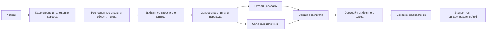
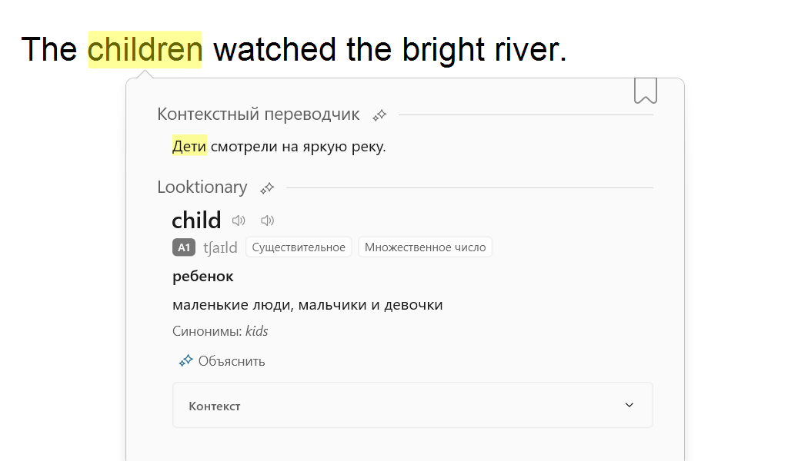
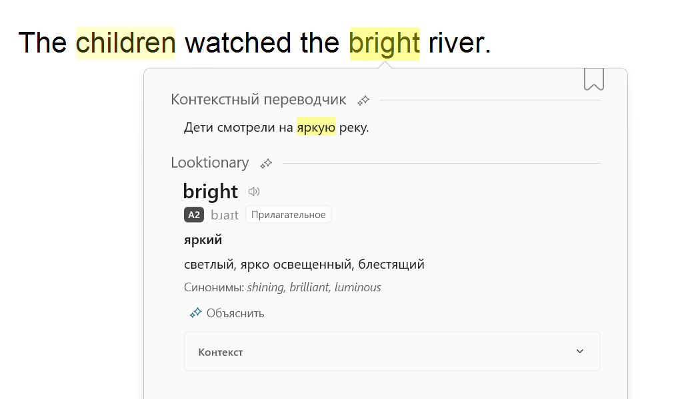

# Устройство Lookupper: от экрана к карточке

Версия исследования: Windows 2.0.6.0, 2026-10-26.
Этот документ позволяет спроектировать Linux-аналог без знания нашей переписки.
Обозначения доказательств раскрыты в [реестре](evidence.md).

## 1. Что получает пользователь

Пользователь читает иностранный текст в другом приложении, наводится на слово
и вызывает Lookupper. Результат появляется возле выбранного текста, сохраняя
связь между словом, его значением и контекстом. В установленной конфигурации
проверен хоткей Alt+Q; это не доказательство неизменяемого хоткея или значения
по умолчанию на всех установках. [W01, W02]

В интерфейсе есть разделы «Слова», «Словари», «Настройки». Режимы
«Всплывающий словарь» и «Экранный переводчик» выбираются отдельно.
Список слов содержит поиск, сортировку, экспорт и синхронизацию с Anki.
В текущем наблюдении выбран порядок «Сначала новые»; наш проект может
использовать другую начальную сортировку. [W01]

## 2. Функциональная схема

Это схема обработки данных, **не извлечённый граф вызовов EXE**.
Порядок выбора словарных и облачных источников внутри оригинала не установлен.

| Этап | Что подтверждено | Что пока неизвестно |
| --- | --- | --- |
| Вызов | Alt+Q открывает `Lookupper Overlay` на контрольной сцене. [W02] | Поведение серии нажатий без закрытия оверлея. |
| Захват | В EXE есть ориентир `DXGIScreenshot` и импорты GDI. [A02, A03] | Реальная ветка захвата и запасной путь в выполненном сценарии. |
| OCR | В сборке лежат детекторы и распознаватели PP-OCRv6 small/tiny и языковые PP-OCRv5. [A03] | Выбранные модели, preprocessing, пороги и GPU/CPU в текущем запуске. |
| Выбор | На контрольной сцене выделяется нужное слово. [W02] | Радиус ближайшего слова, правила пробелов, порядок при пересечении областей. |
| Результат | Одна карточка показывает контекстный перевод и Looktionary. [W02] | Порядок сетевых запросов, кеширование и отмена старого запроса. |
| Сохранение | Есть отдельная кнопка и переключатель автосохранения. [W01, W02] | Когда меняется счётчик, критерий дубля, граница транзакции. |

## 3. Слово, словарная форма и контекст

Это разные сущности; их нельзя заменять одной строкой.

| Сущность | Пример из контрольной сцены | Зачем нужна |
| --- | --- | --- |
| Исходная форма | `children` | Подсветить то, что действительно написано на экране. |
| Словарная форма | `child` | Показать заголовок статьи и связать формы слова. |
| Контекст | `The children watched the bright river.` | Выбрать значение и сохранить ситуацию употребления. |
| Перевод слова | «ребенок» | Кратко объяснить выбранное слово. |
| Перевод контекста | «Дети смотрели на яркую реку.» | Помочь понять предложение целиком. |

Вторая проверка на том же тексте дала `bright` → «яркий». Карточка сместилась
к новому слову и подсветила соответствующий фрагмент перевода. Тесты выполнялись
с Esc между вызовами; одновременные запросы этим не проверялись. [W02]

По снимкам подтверждён видимый переход `children` → `child`, но не место
лемматизации: результат мог сформировать облачный источник, локальный слой
или их сочетание. Локальный Hunspell сам по себе не доказывает, что именно
он обработал это слово. [A03, W02]

Определение «контекста» в общем случае ещё открыто. В тесте был один короткий
текстовый блок. Это не устанавливает правила склейки строк, распознавания
абзацев, выбора предложения и обработки двух соседних диалогов.

## 4. Словари и перевод — отдельные источники

Поставляемые зависимости и ресурсы показывают собственный словарный слой,
HTML-представление статей, Hunspell и языковые ресурсы сегментации.
Они объясняют возможные роли компонентов, но не полный порядок исполнения. [A03, A05]

В проверенном оверлее две самостоятельные секции: «Контекстный переводчик»
и Looktionary. Следовательно, представление результата умеет объединять
несколько секций. Это не доказательство правила «сначала офлайн, затем облако»
в оригинале; такое правило уже выбрано отдельно для LookUpLinux. [W02, L01]

По документации офлайн-словари и OCR работают без сети; облачные источники
и произношение требуют соединения. Это заявление автора, не результат
проведённого нами отключения сети. [P01]

В EXE есть адреса шлюзов и маршруты Looktionary/перевода. Они не задают
доступный нам публичный API: методы, авторизация и схемы не восстановлены.
Linux-аналог использует собственный слой провайдеров, принятый в проекте. [A02, L01]

## 5. Представление карточки

На снимках видны заголовок словарной формы, транскрипция, часть речи,
краткий перевод, определение, дополнительные языковые пометки и контекст.
Наличие полей в конкретном ответе не означает, что они доступны у любого
слова или в любом офлайн-словаре. [W02]

Отдельный поставляемый JS обрабатывает аудиоссылки через переиспользуемый
элемент Audio и раскрывает дополнительные части статьи. Это подтверждённая
статическая логика статьи; выполнение аудио в тесте не проверялось. [A05]

Подсветка слова и привязка карточки к нему — важное свойство сценария.
Точная геометрическая формула, поведение на краю монитора и правила закрытия
по клику или потере фокуса ещё не установлены.

## 6. Что хранится

Поставляемая цепочка SQL-миграций описывает `Cards` и связанные `Resources`.
Старые `SavedWords` и `OpenAIDatas` удаляются позднейшими миграциями;
начальная схема не является актуальной моделью. Пользовательская БД не читалась. [A04]

Логические группы полей:

- **Идентичность:** постоянный GUID, время создания/обновления, версия приложения.
- **Исходник:** исходное слово, словарная форма, язык, HTML-контекст,
  имя исполняемого файла и заголовок окна.
- **Результат:** определение и его язык, перевод слова и контекста,
  язык перевода, чтение, IPA и дополнительные учебные поля.
- **Ресурсы:** тип, имя файла, язык, прямоугольники кадрирования и контекста.

Это поддерживаемые схемой данные, а не доказательство заполнения всех полей
при каждом запросе. Координаты изображений не устанавливают, как получен
сам скриншот и когда он сохраняется.

## 7. Сохранение и обучение

В UI существуют ручное сохранение и автосохранение. На время контрольных
проверок автосохранение выключалось, затем было возвращено в `On`.
Кнопка ручного сохранения не нажималась, библиотека специально не изменялась. [W01, W02]

Официальное руководство описывает экспорт `.apkg` и повторение в Anki;
кнопки Again/Hard/Good/Easy относятся к Anki. Само руководство помечено
автором как устаревшее для 2.0, поэтому детали приоритетнее проверять
в установленной версии. Отдельный встроенный SRS Lookupper не подтверждён. [P03, P04]

Наличие схем коллекции Anki и зависимости Anki.NET согласуется с экспортом,
но не подтверждает внутренний алгоритм повторения Lookupper. Собственное
повторение LookUpLinux остаётся самостоятельным решением LEARN-01. [A03, A04, L01]

## 8. Что требует замены на Linux

| Роль | Оригинал: наблюдение или ориентир | Решение LookUpLinux |
| --- | --- | --- |
| Вызов из другого приложения | Глобальный Alt+Q в проверенной установке. | KDE Shortcuts и команда фонового приложения. |
| Экран и координаты | Windows-зависимый захват; точная ветка не прослежена. | Проверяемый KDE/Wayland backend, согласованные координаты. |
| OCR | PP-OCR-модели в сборке. | Уже выбранный Tesseract; смена только после сравнения качества. |
| Окна и статьи | WinUI, WebView2, встроенный JS. | PyQt6, тема Breeze и поддерживаемое представление словаря. |
| Библиотека | Схема карточек и ресурсов оригинала. | Своя схема истории и учебных карточек. |
| Перевод | Видимые облачные секции и строковые ориентиры шлюзов. | Офлайн-словари и собственные онлайн-провайдеры проекта. |

Устройство Windows-версии не предписывает использовать те же библиотеки
или переносить её базу. Сопоставляемый результат — сценарий пользователя
и полезные данные, а не одинаковый исполняемый код.

## 9. Где нужен следующий точечный разбор кода

Сначала проверяются вопросы из [протокола](evidence.md#следующие-проверки).
Если наблюдение не различает гипотезы, ищем конкретную функцию и её ближайшие
вызовы: выбор слова по координатам, построение контекста, фиксацию результата
или отмену запроса. Полная декомпиляция 116 тысяч процедур не является
условием реализации аналога. Новые запросы Ghidra нужно объединять в одной
живой сессии: имеющийся snapshot не сохраняет её базу.
