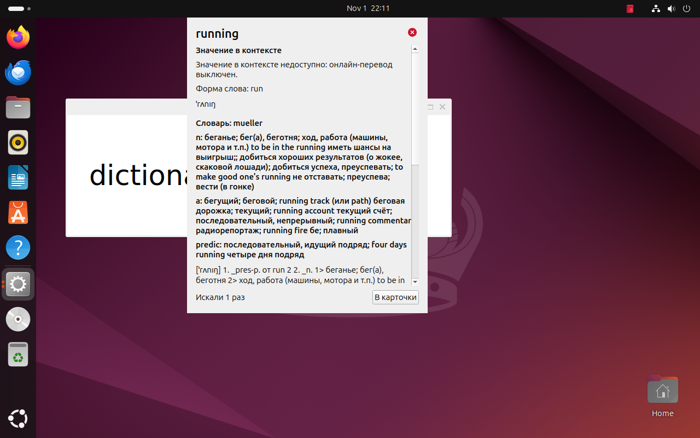

# Ubuntu VM validation

Agent acceptance on Ubuntu 24.04.4 / GNOME Shell 46.0 / Mutter 46.2, Wayland,
VirtualBox VM `discourse-ubuntu-2404` (`e178b651-d035-4a30-b8b1-cea26bcf57d6`).
This is automated agent testing, not human acceptance.

Host session date: 2026-11-02. Guest clock was 2026-11-01 UTC.

## Native Ubuntu checks

- Installed PyQt6 6.6.1 / Qt 6.4.2, Qt Wayland, Tesseract 5.3.4, English model and wl-clipboard.
- Installed and enabled `lookup-linux@lookup.local`; extension state `ACTIVE`.
- Real monitor capture: 1280×800; real cursor and work area: passed.
- Change shortcut to Meta+Shift+E and roll back to Meta+Shift+D: passed.
- Place a real native Qt window: passed.
- `python3 -m lookup --doctor`: exit 0, all six checks OK, real Mueller dictionary 46,231 entries.
- Native application check: `tools/check_ubuntu_app.py`, real Mueller dictionary,
  isolated temporary profile, online translation disabled, no mocked platform/capture/OCR.
- Input came from VirtualBox keyboard scancodes and absolute mouse events.

| Physical hotkey scenario | Result | Article count | History saved | Popup |
|---|---|---:|---|---|
| Cursor over rendered `dictionary`, PRIMARY cleared | OCR → `dictionary` | 1 | yes | 440×419, no focus error |
| PRIMARY contains `running` | selection → `running` | 1 | yes | 440×540, no focus error |

Final native report: `ok: true`; SQLite history contains `dictionary`, `running`.
Engine elapsed times in that run were approximately 902 ms and 274 ms; these
exclude parts of the physical hotkey launch and painting path and are not
end-to-end latency claims. Escape was injected after the final screenshot.

The native run exposed a Mutter resize issue: moving the newly resized popup
could restore its previous height. GNOME presentations now constrain the requested
height; the repeated native check verified the long article at 540 px. KDE keeps
its existing presentation path.

## Automated tests

- Ubuntu targeted adapter/platform/lifecycle/doctor/app/GUI/settings/learning/release
  suite: **118 tests, OK**.
- Ubuntu full suite with its default English OCR model: **814 tests, 11 failing
  OCR subtests, 20 skipped, no errors**. The failures are three game-image cascade
  expectations and eight icon-noise cases returning `xx`/`xxx` instead of no word.
  These classes also failed in the initial pre-adaptation Ubuntu run. This full
  suite is **not** claimed green.
- Testing the Arch English model temporarily on Ubuntu reduced those fixture
  failures to three game-cascade expectations; the system model was not replaced.
- Arch full regression: **814 tests, OK (20 skipped)**, 78.494 s. An earlier
  concurrent run hit an existing wall-clock timeout assertion at 1.040 s against
  a 1 s bound; the complete repeat passed without changing the implementation
  or weakening that test.

The system OCR environments differ:

| Environment | Tesseract | Leptonica | `eng.traineddata` SHA-256 |
|---|---|---|---|
| Ubuntu | 5.3.4 | 1.82.0 | `7d4322bd2a7749724879683fc3912cb542f19906c83bcc1a52132556427170b2` |
| Arch | 5.5.3 | 1.87.0 | `daa0c97d651c19fba3b25e81317cd697e9908c8208090c94c3905381c23fc047` |

The shared OCR implementation was left intact by this adaptation to preserve
the validated Arch behavior. The fixture differences remain a portability limit.

## Arch isolation and limits

Regression code was unpacked to `/tmp/lookup-ubuntu-final` in the existing owned
`lookup-gsd-07` clone. The installed Arch application and its configuration were
not replaced. The original `arch-kde` VM was not started or modified.

Running the new source's doctor inside the existing KDE user session returned
exit 0, including KWin/ScreenShot2/KGlobalAccel and the existing **Meta+Shift+E**
binding. Source CLI lookup of `running` with the installed Mueller dictionary
also returned the real article.

Ubuntu desktop setup lives at `/home/tester/lookup-ubuntu-final`; user launchers
point there. A copy of the user's existing Mueller dictionary was added under
`~/.local/share/lookup/dicts/mueller7` without overwriting existing files.
The normal application was started after the temporary smoke test.

Not verified on Ubuntu: online providers, fullscreen games, multiple monitors,
fractional scaling, X11, other GNOME versions. Twenty full-suite tests require
historical private evidence or optional dependencies and were skipped. Existing
KDE fullscreen/game acceptance is not extended to GNOME by these results.
